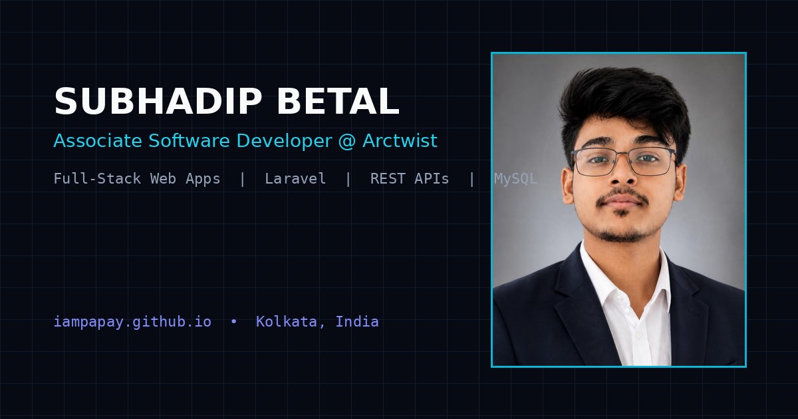

# Subhadip Betal — Developer Portfolio (`Iampapay.github.io`)

[](https://iampapay.github.io)
[](https://www.linkedin.com/in/subhadip316)
[](https://github.com/Iampapay)

Production-ready, single-page developer portfolio for **Subhadip Betal** (Associate Software Developer at **Arctwist Technology Solutions**, Rajarhat, Kolkata).



## Live URL

- **Production Site:** [https://iampapay.github.io](https://iampapay.github.io)
- **Downloadable Resume:** [assets/resume.pdf](assets/resume.pdf)

## Tech Stack & Architecture

- **Core:** Semantic HTML5, Modern CSS3 (Custom Properties, Grid, Fluid `clamp()` Typography, Glassmorphism), Vanilla JavaScript (ES6+)
- **Animations:** Interactive HTML5 `<canvas>` Particle/Neural Network, Orbiting Skill Radar Canvas, 3D Card Tilt + Radial Spotlight, GSAP 3 + ScrollTrigger
- **Theming:** Zero-FOUC Dark & Light Theme Switcher (`localStorage` + `prefers-color-scheme`)
- **Accessibility & SEO:** WCAG AA contrast in both themes, keyboard navigation, `prefers-reduced-motion` support, Open Graph / Twitter Cards, JSON-LD `Person` Schema, `sitemap.xml`, and `robots.txt`

## Project Structure

```text
Iampapay.github.io/
├── index.html                    # Main portfolio entry point (all 11 sections + SEO + JSON-LD)
├── css/
│   └── styles.css                # Complete stylesheet (dark/light themes, fluid type, responsive)
├── js/
│   ├── config.js                 # Single source of truth for personal info, projects & Formspree ID
│   └── main.js                   # Canvas particle engine, theme toggle, filters, tilt & form logic
├── assets/
│   ├── resume.pdf                # Printable 1-page resume for Subhadip Betal
│   ├── icons/
│   │   └── favicon.svg           # Custom SB vector favicon
│   └── images/
│       ├── profile-studio.jpg    # Optimized studio portrait
│       ├── profile-candid.jpg    # Optimized candid office portrait
│       └── og-preview.jpg        # 1200x630 Open Graph social preview card
├── sitemap.xml                   # Search engine sitemap
├── robots.txt                    # Crawler directives
├── CNAME.example                 # Rename to CNAME if binding a custom domain
├── .nojekyll                     # Bypasses Jekyll processing on GitHub Pages
└── README.md                     # Documentation & deployment guide
```

## Quick Deployment to GitHub Pages

```bash
git init
git add .
git commit -m "feat: initial launch of Subhadip Betal portfolio"
git branch -M main
git remote add origin https://github.com/Iampapay/Iampapay.github.io.git
git push -u origin main
```

Then in your GitHub repository, navigate to **Settings → Pages → Build and deployment**, select **Deploy from a branch**, and choose **`main` / `/ (root)`**.

## License

© 2026 Subhadip Betal. All rights reserved.
